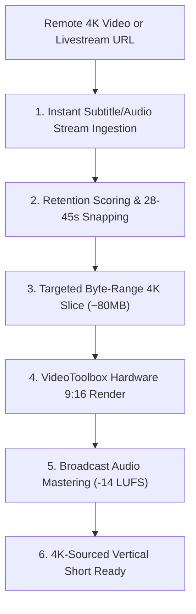

# Online 4K Video & Live Stream Clipper

Produce high-retention 9:16 vertical shorts from any online 4K video or active livestream **without ever downloading massive 10GB–80GB full video files**.

This skill uses remote byte-range streaming to inspect transcripts/audio in seconds and slice **only** the high-potential 28–45s 4K segments directly from the platform's CDN.

---

## Why Online 4K Clipping?

| Metric | Traditional Workflow | Online 4K Stream Clipper |
|---|---|---|
| **Data Downloaded** | 15 GB – 50 GB | **50 MB – 120 MB** (99.7% reduction) |
| **Ingestion Time** | 15 – 45 minutes | **1.5 seconds** (instant subtitle manifest) |
| **Storage Consumption** | Massive disk churn | **Zero wasted disk space** |
| **Output Fidelity** | Often capped at 1080p | **True 4K (2160x3840) or 4K-supersampled 1080p** |

---

## 1. Quick Start (Zero-Touch Pipeline)

Run the end-to-end clipper on any YouTube video or livestream URL:

```bash
python3 scripts/clip_online_pipeline.py "<YOUTUBE_URL>" --out output_shorts --top 1
```

For live streams currently on air, add `--live`:
```bash
python3 scripts/clip_online_pipeline.py "<LIVESTREAM_URL>" --live --out output_shorts
```

---

## 2. Step-by-Step Modular Workflow

### Step 1: Zero-Download Transcript Discovery
Extract full timed subtitles in under 2 seconds without downloading video:
```bash
python3 scripts/fetch_transcript_online.py "<URL>" --out work/session_01
```
*If remote captions are unavailable, it automatically streams only the low-bitrate AAC/Opus audio track and runs faster-whisper locally.*

### Step 2: High-Retention Moment Scoring
Rank candidate windows based on speech velocity, question hooks, and emotional trigger keywords:
```bash
python3 scripts/find_moments_online.py work/session_01/transcript.json --top 3
```
*Generates `clips.json` with precise start and end times snapped to word boundaries with `+0.35s` trailing padding.*

### Step 3: Targeted Remote 4K Slicing
Stream and download **only** the selected 30–45s window in native 4K (2160p / 3840x2160):
```bash
python3 scripts/slice_4k_remote.py "<URL>" --start 142.5 --end 178.0 --out work/session_01/slice_4k_01.mp4
```

### Step 4: Hardware-Accelerated 9:16 Vertical Render
Reframe the 4K horizontal clip into vertical 9:16 with non-overlapping kinetic highlighted subtitles and broadcast loudness normalization (-14 LUFS):
```bash
python3 scripts/render_4k_vertical.py work/session_01/slice_4k_01.mp4 --hook "WATCH THIS MOMENT" --out output_shorts/short_01.mp4 --mode 1080p
```
*Pass `--mode 4k` to render full 2160x3840 Ultra-HD vertical canvas.*

---

## Architecture Diagram


