# ViceLoop GTA VI Shorts Engine

Produce high-retention, copyright-safe 9:16 GTA VI YouTube Shorts from YouTube videos, livestreams, or trailers—engineered to clear the 3,000-view test-batch ceiling and drive comments and likes.

All helper scripts live in `<skill-dir>/scripts/` and can be invoked directly with `python3 <skill-dir>/scripts/<script>.py`.

---

## 1. Strict GTA VI Topic Lock (Scout Filter)

Before downloading or clipping any source video:
- **Allowlist:** Only accept videos or segments matching `GTA 6`, `GTA VI`, `Grand Theft Auto VI`, `Vice City`, `Leonida`, `Jason`, `Lucia`, or `Rockstar Games`.
- **Reject:** Skip general gaming compilations, unrelated streamers (e.g., Fortnite, Valorant, Minecraft, Warzone), or non-GTA clips before transcription.

```bash
python3 scripts/filter_gta6.py --url "<YOUTUBE_URL>"
```
*Exits with code 0 if verified against the allowlist, exits code 1 if rejected with a descriptive reason.*

---

## 2. Clipping YouTube Videos & Livestreams

When given a YouTube video, VOD, or livestream URL:

1. **Download:** Use `yt-dlp` (up to 1080p MP4) plus live chat replay if available:
   ```bash
   python3 scripts/download.py "<URL>" --out work/<id>
   ```
2. **Transcribe:** Run `faster-whisper` with `word_timestamps=True` to generate word-level `transcript.json`:
   ```bash
   python3 scripts/transcribe.py work/<id>/source.mp4 --model base
   ```
3. **Score Hype:** Rank segments combining audio loudness spikes, excited speech, and chat velocity spikes:
   ```bash
   python3 scripts/find_hype.py work/<id> --top 5
   ```
4. **Enforce 28-45s Duration:** Select **28-45 second** self-contained segments (avoid sub-15s clips that fail absolute watch-time gates). Snap `start` and `end` to word boundaries (`end` at least 0.3s after the final spoken word) so no sentence cuts off mid-thought. This generates `work/<id>/clips.json`.

---

## 3. Retentive VoiceOver Scripting (Hook -> Escalation -> Payoff -> Loop)

Rewrite or narrate clips for **VoiceStudio** (~100-130 words for 35-45s) using short, punchy spoken sentences and contractions:

```bash
python3 scripts/script_generator.py --topic "GTA 6 Police AI" --out work/<id>/script_01.json
```

- **0-3s Hook:** Start on frame 1 with a bold claim, mystery, or consequence (under 12 words). Never open with greetings ("Hey guys", "So today").
- **3-18s Escalation:** Raise the stakes with a second reveal or mechanic every 3-5 seconds.
- **18-32s Payoff + Comment Trigger:** Deliver the reveal and put a **1-question debate or vote prompt** on screen (e.g., `"Clean or Psycho? Vote below"`).
- **32-40s Seamless Loop:** End on a dangling lead-in or punchline that flows grammatically right back into the 0-3s opening line.

---

## 4. Copyright-Safe Audio & Mastering

- **Strip Copyrighted Music:** Never leave licensed Rockstar trailer tracks or stream BGM in the final Short (prevents WMG/label territory blocks).
- **Replace & Mix:**
  - Synthesize narration via VoiceStudio or local neural VO (`-12` to `-14 LUFS`).
  - Add royalty-free synth/phonk BGM ducked to **10-15% volume (-24 dB under speech)**.
  - Inject subtle whoosh/impact SFX on visual cuts and hook entrance.
  - Final broadcast master locked to **`-14.0 LUFS`** via FFmpeg `loudnorm`.

---

## 5. Clean 9:16 Layout & Captions

```bash
python3 scripts/make_shorts.py work/<id> --clip 1
```

- **No Duplicate Facecams or Placeholder Boxes:** Check if the source clip already has a corner facecam before adding a split `facecam` overlay. Never render blank `"VOICEOVER"` fallback boxes; use clean gameplay with a subtle 5-10% push-in.
- **No ASS Caption Overlap:** Clamp every caption word's `end` timestamp so `end <= next_word_start`. Show 1-3 bold words at a time inside the vertical safe zone (above the bottom 25% UI bar, below the top 20% header).
- **Cut Every 2-3s:** Use zoom punches, B-roll swaps, or text callouts so no frame sits static for more than 3 seconds.
- **Visual QA Check:** Generates a 3-frame preview contact sheet (`short_XX_preview.jpg`) to confirm zero caption overlap, zero duplicate facecams, and clean framing.

---

## 6. Clean Metadata & Pre-Upload QA

```bash
python3 scripts/metadata_generator.py --id 1 --title "The Secret Cop AI in GTA 6" --hook "THE SECRET COP AI REVEALED" --out work/<id>/metadata_01.json
```

- **Titles:** Under 60 characters, curiosity-driven, **zero emojis** (prevents box-rendering glitches).
- **Pinned Comment:** Output a matching debate question for every Short to boost comment velocity.
- **Hashtags:** Put 3-5 niche tags (`#gta6 #gtavi #vicecity #rockstargames #shorts`) in the description.
- **Pre-Upload Visual Check:** Inspect `short_XX_preview.jpg` before uploading.

---

## Architecture Reference

```mermaid
flowchart TD
    A["YouTube / Livestream URL"] --> B["1. Strict GTA VI Scout Filter"]
    B -->|Passed| C["2. yt-dlp Download & Whisper Transcription"]
    B -->|Rejected| X["Halt / Skip Video"]
    C --> D["3. Hype Detection & 28-45s Word Snapping"]
    D --> E["4. 4-Phase Hook-to-Loop Scripting"]
    E --> F["5. VoiceStudio VO & Copyright-Safe Synth Bed"]
    F --> G["6. 9:16 Render & Overlap-Free Kinetic ASS"]
    G --> H["7. 3-Frame Visual QA & Clean Metadata"]
    H --> I["8. YouTube Shorts Ready to Publish"]
```


